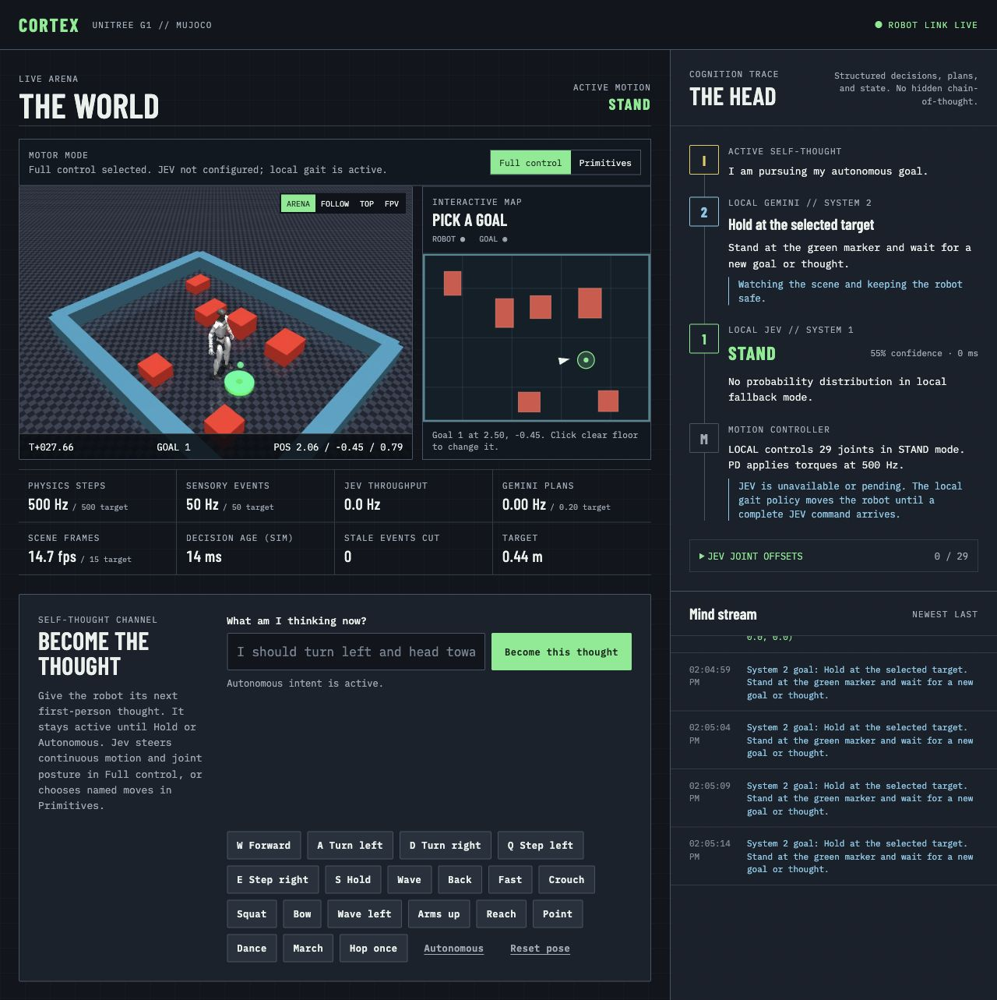
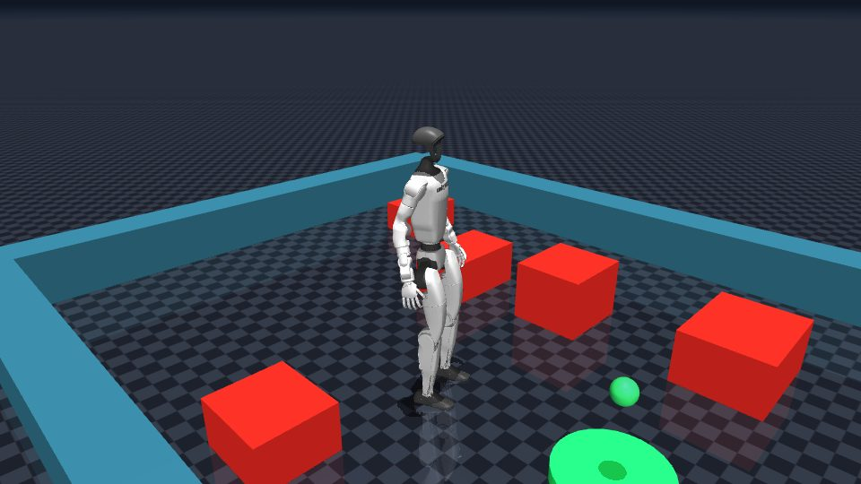
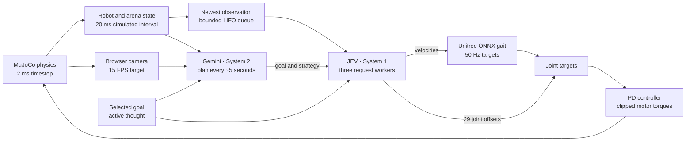

<div align="center">

# JEV robot

**Two model loops. One simulated humanoid. Every joint visible.**

A Unitree G1 in MuJoCo, with JEV making motor decisions and Gemini planning from the live scene.

[](https://github.com/arterialist/jev-robot/actions/workflows/ci.yml)
[](https://github.com/arterialist/jev-robot/blob/main/pyproject.toml)
[](https://mujoco.org/)
[](LICENSE)
[](#what-this-demo-can-and-cannot-do)

[Get started](#try-it-without-api-keys) · [Running guide](docs/running.md) · [Architecture](docs/architecture.md) · [Contribute](CONTRIBUTING.md)



</div>

Click a point on the arena map and watch the G1 work toward it. Switch to its first-person camera, give it an explicit thought, or inspect the requested velocities and all 29 joint targets as the simulation runs. The control room shows model latency and measured update rates, so slow remote decisions remain visible.

## Try it without API keys

Install [uv](https://docs.astral.sh/uv/getting-started/installation/) and Git, then run:

```bash
git clone https://github.com/arterialist/jev-robot.git
cd jev-robot
uv sync --python 3.12
uv run jev-robot-web --offline
```

The browser opens at [127.0.0.1:8000](http://127.0.0.1:8000). Offline mode uses deterministic local decisions with the same MuJoCo simulation and Unitree gait policy. The first run still needs internet access to download dependencies, the G1 model, and the walking policy into your user cache.

For a quick run without a window or model calls:

```bash
uv run jev-robot --headless --offline --seconds 5 --no-realtime
```

The browser and image capture need an OpenGL rendering backend. macOS has a dedicated native-viewer launcher; see the [platform notes](docs/running.md#platform-notes) for other setups.

## Connect JEV and Gemini

Copy the environment template and add your [OpenRouter key](https://openrouter.ai/settings/keys) and [Gemini key](https://aistudio.google.com/apikey):

```bash
cp .env.example .env
# Fill in OPENROUTER_API_KEY and GEMINI_API_KEY in .env.
uv run jev-robot-web
```

The code defaults to `~typesafe/jev-latest` through OpenRouter's Decisions API and `gemini-3.8-flash` through Google's GenAI SDK. You can override both in `.env`. Each loop falls back independently when its key is missing or its request fails. Check the model status in the control room to see which source is active. Remote API calls may incur provider charges.

## Drive and inspect

| Control | What happens |
| --- | --- |
| Click the map | Move the green target without resetting the robot. Goals inside obstacles are rejected. |
| Full control | JEV chooses forward, lateral, and turning velocities, plus bounded offsets for all 29 joints. Unitree's policy handles gait timing and balance. |
| Primitives | JEV selects a named movement. The local gait and pose controllers execute walking, turns, gestures, and posture changes. |
| Arena / Follow / Top / FPV | Change the streamed camera. The browser sends that camera frame to Gemini when its planner runs. |
| Thought field or W/A/D/Q/E/S | Set the robot's active first-person intent. It stays active until replaced or released with Autonomous. |
| Reset pose | Return the robot to its starting pose. A fall otherwise remains in the simulation. |

The visible thought is user-supplied intent, and the model's status note is a short public output. The interface does not expose private chain-of-thought.

<details>
<summary>View the simulated arena</summary>



</details>

## How the loops connect



JEV workers take the newest available observation. A completed response cannot replace a decision based on a newer observation. Goal, thought, and control-mode changes also invalidate old decisions. The 500 Hz physics target does not imply 500 Hz model feedback. See [architecture and timing](docs/architecture.md) for the full control path and telemetry definitions.

## What this demo can and cannot do

This is a simulation prototype. The G1's contacts, rigid-body dynamics, and actuator limits come from the Unitree model. A local ONNX policy produces walking targets; JEV chooses numeric velocity levels and shapes those targets with joint offsets. It does not generate every torque or learn a gait during the run.

The robot can fall, stall, or collide. Short motion projections suppress unsafe translation, but they do not prove a collision-free route. Repeated hopping is unstable. There is no scripted route or lap reset, and the controller does not overwrite root velocity or apply a hidden pelvis force. MuJoCo's numerical-instability guard can still restore a broken state.

The project has no physical robot integration. Physics and ONNX inference run locally on CPU; JEV and Gemini run through remote APIs when enabled. The web server binds to loopback by default and has no authentication. Keep it local unless you add access controls.

## Project guide

| File or directory | Purpose |
| --- | --- |
| [`src/jev_robot/brains.py`](src/jev_robot/brains.py) | JEV decisions, Gemini plans, event queues, and fallback behavior |
| [`src/jev_robot/simulation.py`](src/jev_robot/simulation.py) | Physics state, goal handling, arrival, and motion limits |
| [`src/jev_robot/locomotion.py`](src/jev_robot/locomotion.py) | Unitree ONNX gait and observation history |
| [`src/jev_robot/web.py`](src/jev_robot/web.py) and [`static/`](src/jev_robot/static) | Browser runtime, video stream, controls, and telemetry |
| [`docs/running.md`](docs/running.md) | API setup, CLI options, platforms, and troubleshooting |
| [`docs/architecture.md`](docs/architecture.md) | Model boundaries, joint control, timing, and assets |

## Credits and upstream projects

The project code is [MIT licensed](LICENSE). The simulator downloads Unitree assets and the walking policy at runtime. Those files retain their upstream licenses; see [third-party notices](THIRD_PARTY_NOTICES.md).

- [Unitree MuJoCo](https://github.com/unitreerobotics/unitree_mujoco) supplies the G1 MJCF and meshes.
- [Unitree RL Lab](https://github.com/unitreerobotics/unitree_rl_lab) supplies the G1 29-DOF velocity policy.
- [MuJoCo](https://mujoco.org/) runs the physics and rendering.
- [TypeSafe](https://typesafe.ai/) supplies JEV, accessed through [OpenRouter](https://openrouter.ai/).
- [Google GenAI](https://googleapis.github.io/python-genai/) supplies the Gemini client.

Bug reports and reproducible experiments belong in [Issues](https://github.com/arterialist/jev-robot/issues). Read the [contribution guide](CONTRIBUTING.md) before changing the control path.
